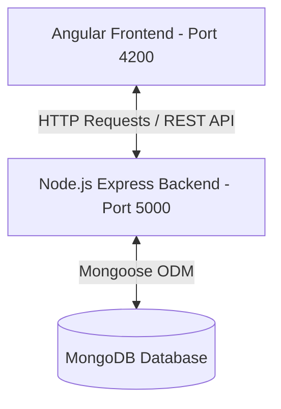
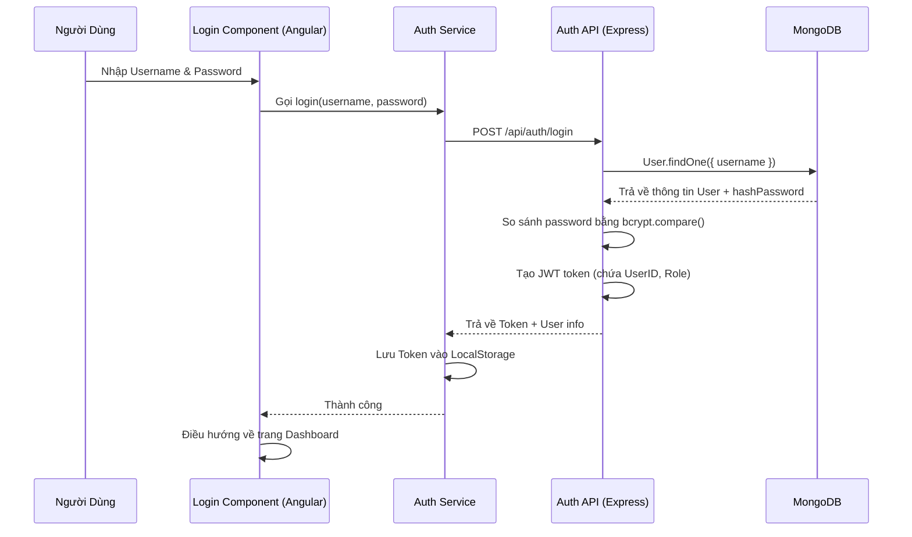
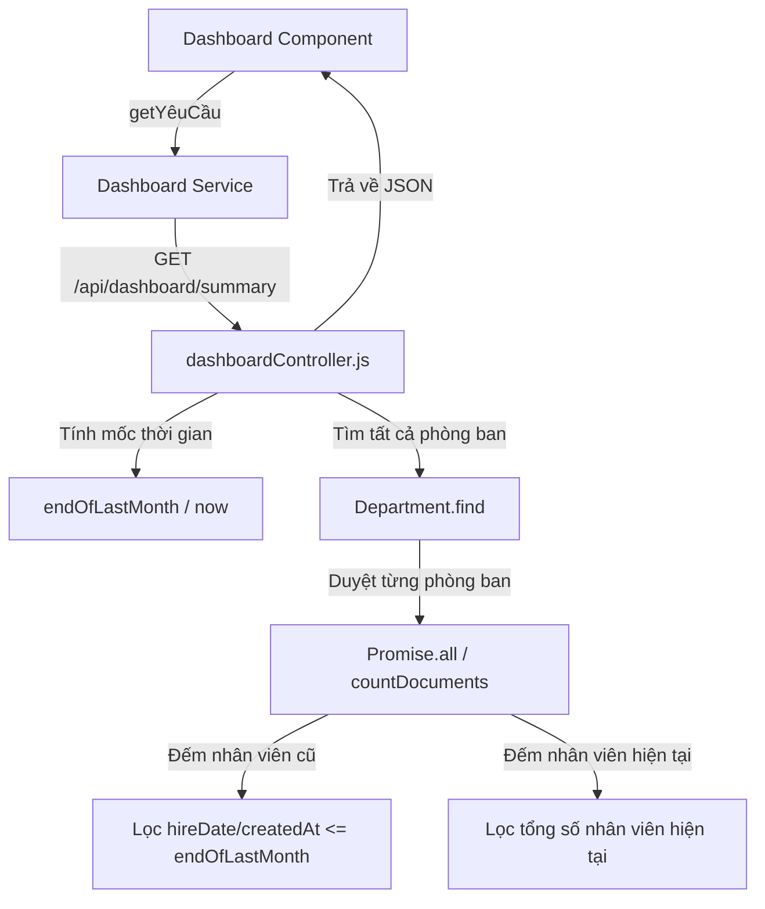

# HƯỚNG DẪN LUỒNG HOẠT ĐỘNG & BẢN ĐỒ MÃ NGUỒN (WORKFLOW & CODEFLOW)
## HỆ THỐNG QUẢN LÝ NHÂN SỰ - HUMAN RESOURCE MANAGEMENT (HRMS)

Tài liệu này mô tả chi tiết kiến trúc hệ thống, cấu trúc thư mục, luồng truyền nhận dữ liệu, và logic nghiệp vụ cốt lõi của toàn bộ dự án HRMS (bao gồm Backend Node.js/Express và Frontend Angular).

---

## 1. KIẾN TRÚC TỔNG QUAN (OVERALL ARCHITECTURE)

Hệ thống hoạt động theo mô hình **Client-Server** truyền thống với cơ sở dữ liệu phi quan hệ **MongoDB**:


- **Frontend**: Được phát triển bằng Angular 18+ (Sử dụng Standalone Components, Signal state management, HttpClient, TailwindCSS/Bootstrap).
- **Backend**: Được xây dựng bằng Node.js, Express, Mongoose ODM. Bảo mật bằng JSON Web Tokens (JWT) và Bcryptjs để mã hóa mật khẩu.

---

## 2. CẤU TRÚC THƯ MỤC DỰ ÁN (DIRECTORY STRUCTURE)

### A. Backend (`hrms-backend/`)
Chứa toàn bộ logic xử lý API, tương tác cơ sở dữ liệu và phân quyền.
- [db.js](file:///C:/Users/Admin/.gemini/antigravity/worktrees/Human%20Resource%20Management%20%28HRMS%29/update-dashboard-department-charts/hrms-backend/config/db.js): Kết nối database MongoDB thông qua Mongoose.
- `models/`: Định nghĩa các lược đồ dữ liệu (Schemas):
  - [Role.js](file:///C:/Users/Admin/.gemini/antigravity/worktrees/Human%20Resource%20Management%20%28HRMS%29/update-dashboard-department-charts/hrms-backend/models/Role.js): Vai trò người dùng (`ADMIN`, `USER`).
  - [User.js](file:///C:/Users/Admin/.gemini/antigravity/worktrees/Human%20Resource%20Management%20%28HRMS%29/update-dashboard-department-charts/hrms-backend/models/User.js): Tài khoản hệ thống (Username, Password mã hóa, liên kết với Employee).
  - [Employee.js](file:///C:/Users/Admin/.gemini/antigravity/worktrees/Human%20Resource%20Management%20%28HRMS%29/update-dashboard-department-charts/hrms-backend/models/Employee.js): Hồ sơ thông tin cá nhân nhân viên.
  - [Department.js](file:///C:/Users/Admin/.gemini/antigravity/worktrees/Human%20Resource%20Management%20%28HRMS%29/update-dashboard-department-charts/hrms-backend/models/Department.js): Thông tin phòng ban.
- `controllers/`: Chứa logic nghiệp vụ của các chức năng (xử lý request, truy vấn DB, trả về JSON).
- `routes/`: Định nghĩa các endpoints API và tích hợp middleware bảo mật.
- `middleware/`:
  - `authMiddleware.js`: Xác thực JWT token và phân quyền Admin/User.
  - `uploadMiddleware.js`: Cấu hình Multer để lưu trữ ảnh đại diện (avatar).
- [server.js](file:///C:/Users/Admin/.gemini/antigravity/worktrees/Human%20Resource%20Management%20%28HRMS%29/update-dashboard-department-charts/hrms-backend/server.js): File khởi tạo server, đăng ký middleware toàn cục, routes và lắng nghe cổng kết nối.

### B. Frontend (`hrsm-frontend/`)
Chứa mã nguồn giao diện người dùng.
- `src/app/core/`: Quản lý bảo mật, Interceptors (gửi JWT tự động trong Header), Guards (chặn truy cập trái phép).
- `src/app/features/`: Các module chức năng chính:
  - `auth/`: Đăng nhập, đăng xuất.
  - `dashboard/`: Báo cáo, số liệu thống kê & biểu đồ Chart.js.
  - `department/`: Quản lý danh sách, thêm, sửa, xóa phòng ban.
  - `employee/`: Quản lý danh sách nhân viên, form thêm/sửa, phân trang, bộ lọc.
  - `profile/`: Xem trang cá nhân, cập nhật số điện thoại, địa chỉ và đổi mật khẩu.
- `src/app/layout/`: Thanh Sidebar điều hướng bên trái và Navbar phía trên cùng.

---

## 3. CÁC LUỒNG HOẠT ĐỘNG CHÍNH (KEY WORKFLOWS)

### Luồng 1: Xác Thực & Đăng Nhập (Authentication & Session Flow)
Khi người dùng mở ứng dụng và nhập tài khoản:

> [!NOTE]
> Mọi request sau đó gửi từ Angular lên Backend đều đi qua `authInterceptor` để tự động đính kèm header `Authorization: Bearer <token>`.

---

### Luồng 2: Thêm Nhân Viên Mới & Cấp Tài Khoản Tự Động (Employee Creation Flow)
Để đảm bảo nhân viên mới luôn có tài khoản đăng nhập mà không cần thực hiện thủ công:
1. **Frontend**: Admin điền form thông tin nhân viên:
   - Các trường bắt buộc có dấu `*` kế bên.
   - Không còn dòng `-- chọn --` trống, thay vào đó là lựa chọn cụ thể mặc định.
   - Validation kiểm tra:
     - **Email**: Tối thiểu 3 ký tự trước chữ `@gmail.com`.
     - **Số điện thoại**: Đủ 10 chữ số và bắt đầu bằng số `0`.
     - **Địa chỉ**: Không cho phép nhập các ký tự đặc biệt linh tinh (`***`, `###`, `@$@$`).
     - **Ngày sinh**: Tính toán độ tuổi từ ngày sinh đảm bảo nằm trong khoảng từ **18 đến 65 tuổi**.
2. **Backend**:
   - Khi API nhận yêu cầu tạo nhân viên, sau khi lưu hồ sơ nhân viên (`Employee.create()`), hệ thống sẽ **tự động** tạo một tài khoản `User` liên kết với nhân viên đó (Mật khẩu mặc định hoặc quy định trước, vai trò được chọn theo vị trí/phòng ban).

---

### Luồng 3: Biểu Đồ Thống Kê Dashboard (Dashboard Chart Flow)
Biểu đồ phân bộ nhân sự theo phòng ban hiển thị số lượng nhân viên so sánh giữa **Tháng trước** và **Tháng này**.


- **Cách tính toán**:
  - `endOfLastMonth`: Điểm cuối cùng của tháng trước (Ví dụ: `23:59:59.999` ngày 30/06/2026).
  - Nhân viên tháng trước: Lọc theo điều kiện `createdAt <= endOfLastMonth` hoặc `hireDate <= endOfLastMonth`.
  - Nhân viên tháng này: Lấy tổng số lượng hiện tại thuộc phòng ban đó.
- **Biểu diễn đồ họa**: Chart.js hiển thị 2 cột màu sắc trực quan đại diện cho mỗi phòng ban giúp Admin dễ dàng nhận thấy sự tăng giảm nhân sự.

---

### Luồng 4: Xem, Sửa Giao Diện Profile & Đổi Mật Khẩu (Profile Flow)
Trang thông tin cá nhân cho phép nhân viên tự quản lý thông tin của mình:
- **Xem thông tin**: Người dùng click vào nút Xem thông tin cá nhân -> Gọi `GET /api/profile` (lấy dữ liệu thông qua ID giải mã từ JWT token).
- **Chỉnh sửa**: Có nút bấm riêng để chuyển sang chế độ chỉnh sửa thông tin liên lạc (Số điện thoại, Địa chỉ).
- **Đổi mật khẩu**: Tích hợp ô nhập mật khẩu cũ, mật khẩu mới (tối thiểu 6 ký tự). Backend kiểm tra tính chính xác của mật khẩu cũ qua bcrypt trước khi lưu mật khẩu mới.

---

### Luồng 5: Xóa Nhân Viên & Phòng Ban (Deletion Flow with Names)
Để tránh nhầm lẫn khi xóa dữ liệu quan trọng:
- Khi bấm nút **Xóa**, hộp thoại xác nhận (Confirm modal/dialog) hiển thị chi tiết tên cụ thể của đối tượng sẽ bị xóa.
- *Ví dụ*: Thay vì hiển thị thông báo chung chung "Bạn có chắc muốn xóa?", hệ thống hiển thị: **"Bạn có chắc muốn xóa nhân viên Nguyễn Văn A?"** hoặc **"Bạn có chắc muốn xóa phòng ban Phòng Kỹ thuật?"**.

---

## 4. CHI TIẾT CÁC ENDPOINT API (REST API LIST)

| Phương thức | Đường dẫn API | Chức năng | Phân quyền |
| :--- | :--- | :--- | :--- |
| **POST** | `/api/auth/login` | Đăng nhập hệ thống, trả về Token JWT | Public |
| **GET** | `/api/dashboard/summary` | Thống kê số lượng & dữ liệu biểu đồ phòng ban | ADMIN / USER |
| **GET** | `/api/employees` | Lấy danh sách nhân viên kèm phân trang, tìm kiếm | ADMIN / USER |
| **POST** | `/api/employees` | Thêm nhân viên mới + tự động cấp tài khoản | ADMIN |
| **PUT** | `/api/employees/:id` | Cập nhật thông tin nhân viên | ADMIN |
| **DELETE**| `/api/employees/:id` | Xóa nhân viên (yêu cầu xác nhận tên) | ADMIN |
| **GET** | `/api/departments` | Lấy danh sách phòng ban | ADMIN / USER |
| **POST** | `/api/departments` | Thêm phòng ban mới | ADMIN |
| **DELETE**| `/api/departments/:id` | Xóa phòng ban (yêu cầu xác nhận tên) | ADMIN |
| **GET** | `/api/profile` | Xem thông tin cá nhân của User hiện tại | ADMIN / USER |
| **PUT** | `/api/profile` | Chỉnh sửa thông tin cá nhân (SĐT, Địa chỉ) | ADMIN / USER |
| **PUT** | `/api/profile/change-password` | Đổi mật khẩu tài khoản đang đăng nhập | ADMIN / USER |

---

## 5. HƯỚNG DẪN BẢO TRÌ & CHẠY DỰ ÁN

1. **Khởi động Backend**:
   ```bash
   cd hrms-backend
   npm install
   npm start # Chạy trên http://localhost:5000
   ```
2. **Khởi động Frontend**:
   ```bash
   cd hrsm-frontend
   npm install
   npm start # Chạy trên http://localhost:4200
   ```
